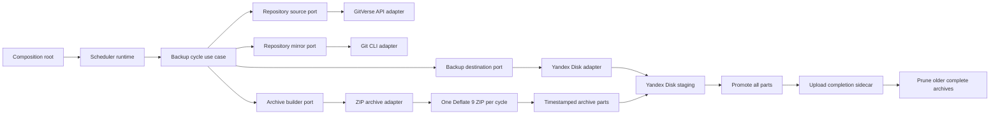

# Architecture

## Configuration

The service reads these required environment variables:

| Variable                  | Purpose                                                                   |
| ------------------------- | ------------------------------------------------------------------------- |
| `GITVERSE_TOKEN`          | Lists and clones repositories visible to the token.                       |
| `BACKUP_CRON`             | Five-field cron schedule: minute, hour, day of month, month, day of week. |
| `TZ`                      | IANA timezone used to interpret `BACKUP_CRON`.                            |
| `YANDEX_DISK_OAUTH_TOKEN` | Authorizes Yandex Disk REST API requests.                                 |
| `YANDEX_DISK_DESTINATION` | Destination URI, for example `disk:/backups/gitverse`.                    |
| `BACKUP_RETENTION_COUNT`  | Required positive count of completed archives to retain.                  |

The scheduler starts an initial cycle, then runs at cron occurrences in the
configured timezone. A cycle that is still running is not started again. On
`SIGINT`, `SIGTERM`, or `SIGHUP`, the service finishes the active cycle and
exits without starting another one.

## Cycle archive and publication

The service discovers all repositories visible to the GitVerse token and
creates a full bare Git mirror for each. It attempts every repository even
when one mirror fails. If any mirror fails, the cycle is unsuccessful and no
archive is published; a later cron occurrence retries repository discovery
and mirroring.

When all mirrors succeed, the service creates one ZIP for the entire cycle.
Its filename uses a UTC timestamp, and each repository is stored at
`{owner}/{repo}/`. Git refs and objects are included. ZIP compression uses
Deflate level 9. If the ZIP exceeds 1,000,000,000 bytes, it is split into
ordered parts that each stay at or below that limit.

Parts are uploaded to a staging directory, promoted to timestamped final
names, then the `{timestamp}.complete.json` completion sidecar is uploaded
last. The sidecar lists the parts and their sizes; consumers should treat the
archive as complete only when this sidecar exists. To restore a multipart
archive, concatenate its parts in numeric order and unzip the result.

## Retention

Retention runs only after the new archive and completion sidecar have been
published. It keeps the newest `BACKUP_RETENTION_COUNT` complete archives.
For each older archive, it removes the completion sidecar before deleting any
archive files. If sidecar removal fails, payload deletion stops. If deleting
payload files fails after sidecar removal, the marker stays absent and the
cleanup is reported as failed. Failed backup cycles do not run retention.

## Components

The backup cycle is a use case that depends on four ports: repository source,
repository mirror, archive builder, and backup destination. GitVerse, Git,
ZIP, and Yandex Disk adapters implement those ports. `main.rs` is the
composition root that creates the production adapters and passes them to the
use case. Tests replace each port independently with a `mockall` mock. Shared
workflow data, including `ArchivePackage`, lives in `models.rs`.

